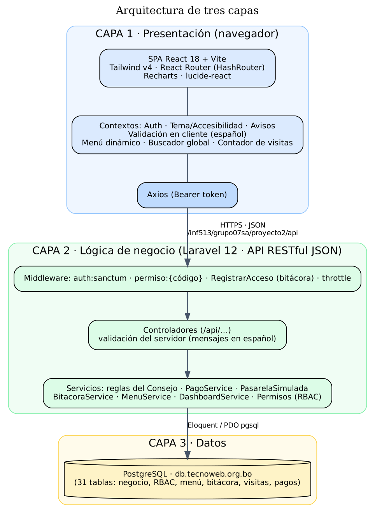
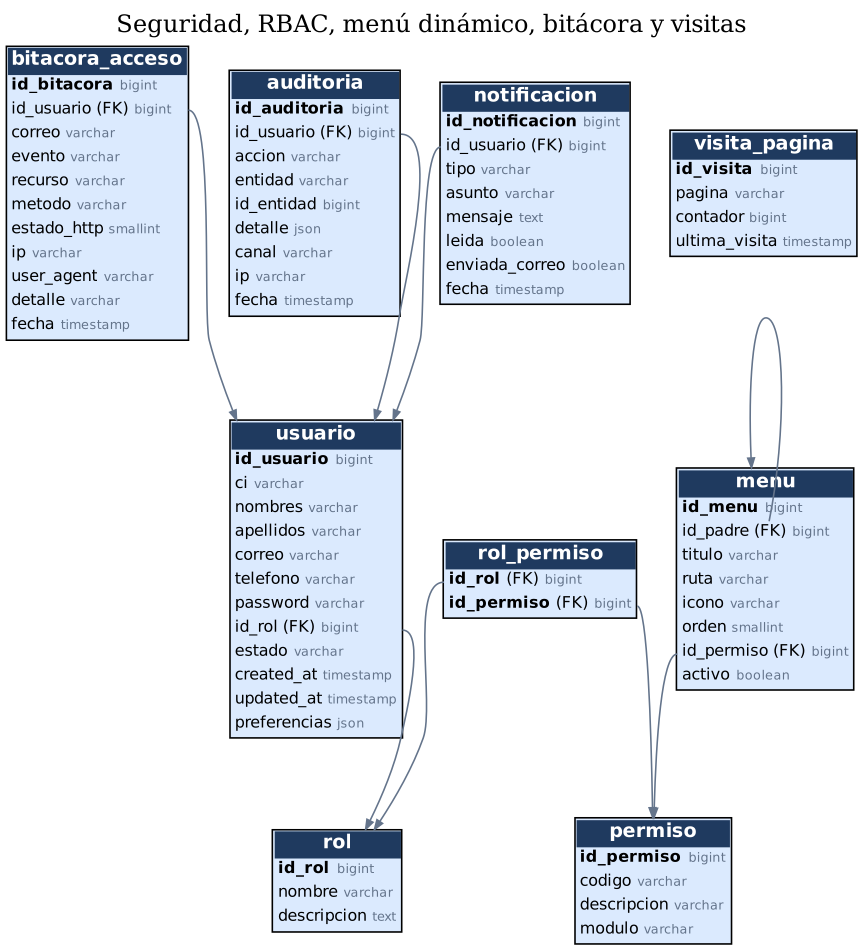
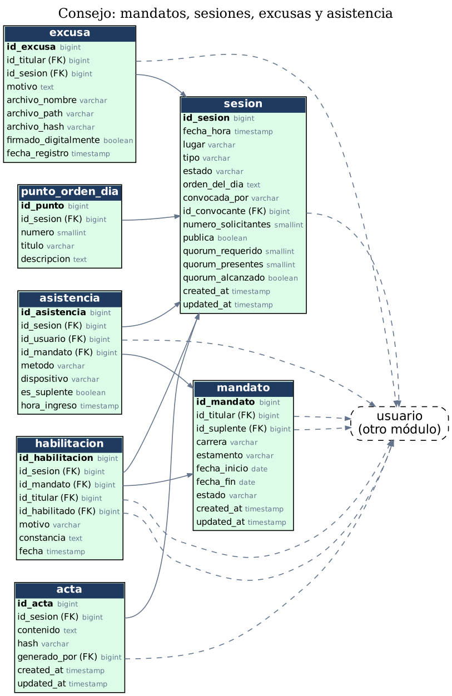
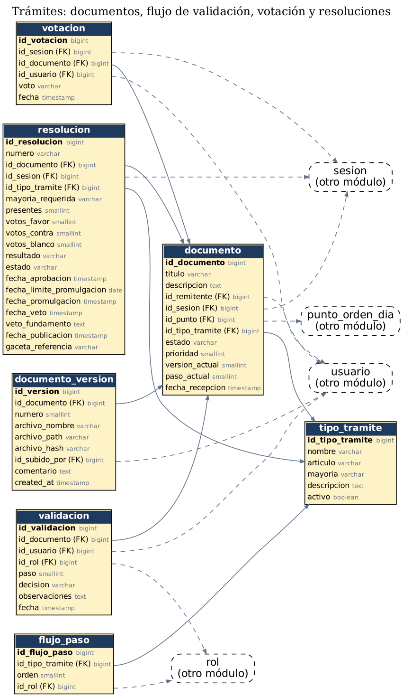
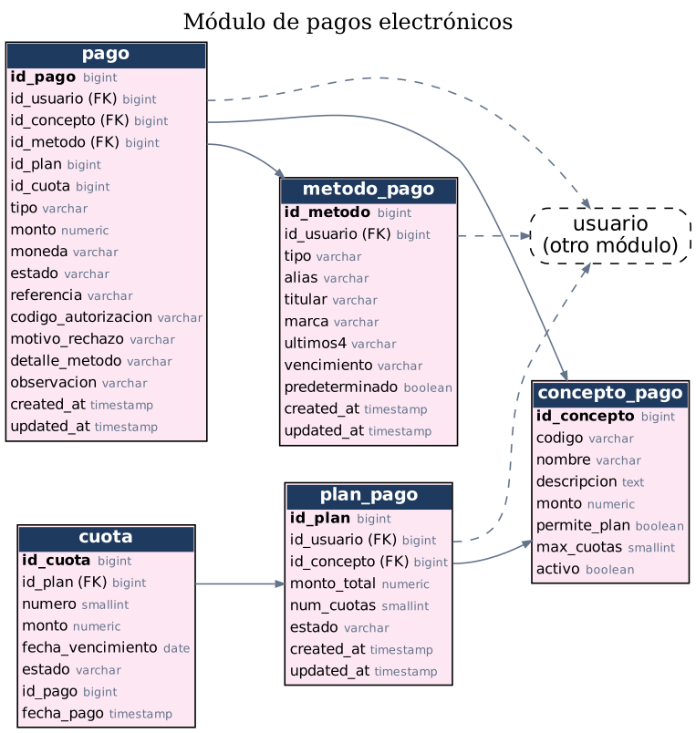

# Documentación técnica — Sistema Web del Consejo Facultativo

**Proyecto No. 2 · Sistema Vía Web (Final)** · INF513 Tecnología Web · Grupo 07SA
Facultad de Ingeniería en Ciencias de la Computación y Telecomunicaciones (FICCT) · UAGRM
Repositorio: `inf513-proyecto2` · Despliegue: `https://www.tecnoweb.org.bo/inf513/grupo07sa/proyecto2`

<!-- pagebreak -->

## 1. Resumen del sistema

El sistema gestiona el trabajo del **Consejo Facultativo** de la FICCT: usuarios y roles, mandatos de los miembros (titular y suplente por carrera y estamento), convocatoria de sesiones con orden del día, excusas y habilitación automática de suplentes, repositorio documental con flujo de validación por tipo de trámite, asistencia y quórum, votaciones, resoluciones (promulgación, veto, publicación en Gaceta), actas con sello SHA-256, fiscalización y reportes. Es la evolución del sistema del primer parcial (**Sistema Vía Mail**), que se mantiene dentro del mismo backend: los mismos servicios de negocio atienden los comandos por correo y la API web.

Para el Proyecto No. 2 se reconstruyó como una **aplicación web de tres capas**: una SPA en React que consume una API RESTful de Laravel sobre PostgreSQL. Se añadieron los módulos exigidos por la cátedra: control de acceso por perfiles almacenado en base de datos, navegación dinámica, bitácora de accesos, contador de visitas, temas y accesibilidad, tablero analítico, búsqueda global y pagos electrónicos.

### Datos de acceso para la defensa

El administrador inicial lo define el seeder con `ADMIN_CORREO` / `ADMIN_CLAVE` de `backend/.env`. Con `SEED_DEMO=true` se crean además usuarios de ejemplo cuya contraseña es `Consejo2026*`:

| Perfil | Correo |
|---|---|
| ADMINISTRADOR | `admin@consejo.test` (clave `Admin2026*`) |
| PRESIDENTE (Decano) | `presidente@consejo.test` |
| SECRETARIO | `secretario@consejo.test` |
| TITULAR_DOCENTE | `titular.docente.inf@consejo.test` |
| TITULAR_ESTUDIANTE | `titular.estudiante.inf@consejo.test` |

## 2. Cumplimiento de los requisitos del Proyecto No. 2

| N° | Requisito publicado | Cómo se cumple | Evidencia |
|---|---|---|---|
| 1 | Arquitectura de 3 capas: React SPA (Vite + Axios), API RESTful Laravel, PostgreSQL | SPA en `frontend/` compilada con Vite; cliente Axios único (`src/api/client.js`); API JSON bajo `/api`; esquema creado con migraciones | Sección 3; `frontend/`, `backend/routes/api.php`, `backend/database/migrations` |
| 2 | Barra de navegación dinámica según los permisos del perfil, leída de la base de datos | Tabla `menu` con jerarquía y permiso requerido; `GET /api/menu` devuelve solo lo permitido; `Sidebar.jsx` la dibuja; el administrador la edita en «Menú dinámico» | Sección 5.3; `SistemaWebTest::test_menu_*` |
| 3 | Roles: al menos 2 perfiles de negocio además del administrador | 7 roles: administrador y 6 de negocio (Presidente, Secretario, titulares y suplentes docentes y estudiantes) | Sección 5.1 |
| 4 | Matriz de acceso que restringe rutas y acciones por perfil | Tablas `permiso` y `rol_permiso`; middleware `permiso:{código}` en cada endpoint; guardas de ruta en React; pantalla «Matriz de acceso» editable | Sección 5.2; `SistemaWebTest::test_matriz_*` |
| 5 | Bitácora persistente: ingresos exitosos, intentos fallidos, IP y recursos más accedidos | Tabla `bitacora_acceso` alimentada por `BitacoraService` y el middleware `RegistrarAcceso`; pantalla «Bitácora de accesos» con filtros y análisis | Sección 5.4 |
| 6 | Identidad visual unificada (Tailwind/CSS) | Tailwind CSS v4 con tokens de diseño ligados a variables CSS; componentes comunes (`.card`, `.btn`, `.input`, `.tabla`…) | `frontend/src/index.css` |
| 7 | Al menos 3 temas dinámicos (Niños, Jóvenes, Adultos) y modo Día/Noche (automático por horario o manual) | Tres temas × dos modos, más alto contraste; el modo automático cambia a noche de 19:00 a 06:00 y se reevalúa cada minuto; se guarda por usuario | Sección 6.1; `tema.test.js` |
| 8 | Herramientas de accesibilidad: tamaño de fuente, contraste, WCAG básico | Control de fuente 80–160 %, alto contraste, enlace «Saltar al contenido», foco visible, etiquetas ARIA, diálogos con foco atrapado, tablas alternativas a los gráficos | Sección 6.2 |
| 9 | Validación estricta en cliente y servidor con mensajes en español | Reglas en `validators.js` + hook `useForm`; validación de Laravel con `lang/es`; errores 401/403/404/405/422/429 en español | Sección 6.3; `SistemaWebTest::test_validacion_*`, `validators.test.js` |
| 10 | Contador de visitas persistente por página, en el pie de cada vista | `POST /api/visitas` suma en `visita_pagina`; `PiePagina.jsx` lo muestra en todas las vistas (incluidas login y portal público) | Sección 6.4 |
| 11 | Tablero con gráficos de negocio y de flujo de accesos | `GET /api/dashboard`; 7 indicadores, 6 gráficos de negocio y, para quien puede ver la bitácora, ingresos/fallos por día y recursos más accedidos | Sección 6.5 |
| 12 | Búsqueda global destacada en el encabezado (predictiva) | Cuadro en el encabezado con consulta a `GET /api/buscar` mientras se escribe (retardo 250 ms), teclado y ARIA `combobox`; solo devuelve módulos permitidos al rol | Sección 6.6 |
| 13 | Pagos electrónicos: métodos de pago por usuario, pagos únicos y planes estructurados | Métodos (tarjeta, QR, transferencia, billetera), pagos únicos con comprobante, planes de 2 a 12 cuotas por usuario; pasarela **simulada** | Sección 7; `PagosTest` |
| 14 | Despliegue en `https://www.tecnoweb.org.bo/inf513/grupo07sa/proyecto2` con esquema PostgreSQL | `deploy.sh`; SPA y API comparten URL; migraciones y seeders crean el esquema | Sección 9 |
| 15 | Repositorio público `inf513-proyecto2` con historial ordenado y entrega `2026-2_INF513-P2_grupo07sa.tar.gz` | Historial de commits por etapas; el paquete incluye esta documentación y el código fuente Laravel y React | Sección 10 |

## 3. Arquitectura



**Capa de presentación (React).** SPA con React 18, Vite, Tailwind CSS v4, React Router (con `HashRouter`, de modo que funciona bajo cualquier subdirectorio sin reglas de reescritura), Recharts para gráficos y lucide-react para iconos. La sesión usa un token Bearer guardado en el navegador. Todo el acceso a datos pasa por un único cliente Axios que adjunta el token, traduce errores a mensajes en español y reacciona a `401` cerrando la sesión.

**Capa de lógica (Laravel 12, PHP 8.3).** API RESTful sin estado. Cada petición atraviesa: autenticación Sanctum → verificación de permiso (`permiso:{código}`) → controlador (validación del servidor) → servicio de negocio → Eloquent. Un middleware terminable (`RegistrarAcceso`) registra cada acceso en la bitácora sin demorar la respuesta. Las reglas del Consejo viven en servicios (`SesionService`, `VotacionService`, `ResolucionService`…), de modo que la API web y el Sistema Vía Mail comparten la misma lógica.

**Capa de datos (PostgreSQL).** Servidor `db.tecnoweb.org.bo`, base `db_grupo07sa`. Esquema versionado con migraciones y poblado con seeders idempotentes.

**Un solo origen.** En producción la SPA compilada se publica en la misma carpeta que el front controller de Laravel: `…/proyecto2/` entrega `index.html` y `…/proyecto2/api/*` lo atiende Laravel. Por eso no hay CORS en producción. En desarrollo, Vite (puerto 5173) usa un proxy hacia `127.0.0.1:8000`.

### 3.1 Estructura del repositorio

```
inf513-proyecto2/
├── backend/            Laravel 12: app/ (Controllers, Services, Models, Middleware, Support, Correo),
│                       database/ (migrations, seeders), routes/api.php, lang/es, tests/, public/ (SPA compilada)
├── frontend/           React + Vite: src/ (api, context, hooks, lib, components, pages), vite.config.js
├── docs/               Esta documentación (Markdown, DOCX y PDF) e imágenes
├── deploy.sh           Despliegue en el servidor de la cátedra
├── COMANDOS_EMAIL.md   Catálogo de comandos del Sistema Vía Mail (primer parcial)
└── README.md
```

## 4. Modelo de datos (PostgreSQL)

El esquema tiene 28 tablas propias del sistema (seguridad, Consejo, trámites y pagos) más 3 técnicas de Laravel y del Vía Mail. Las figuras muestran cada módulo; las líneas continuas son claves foráneas internas y las punteadas apuntan a tablas de otro módulo.









### 4.1 Diccionario de datos

En negrita, las claves primarias.

#### Seguridad, RBAC y trazabilidad

- `usuario`: **id_usuario**, ci, nombres, apellidos, correo, telefono, password, id_rol, estado, created_at, updated_at, preferencias.
- `rol`: **id_rol**, nombre, descripcion.
- `permiso`: **id_permiso**, codigo, descripcion, modulo.
- `rol_permiso`: **id_rol**, **id_permiso**.
- `menu`: **id_menu**, id_padre, titulo, ruta, icono, orden, id_permiso, activo.
- `bitacora_acceso`: **id_bitacora**, id_usuario, correo, evento, recurso, metodo, estado_http, ip, user_agent, detalle, fecha.
- `visita_pagina`: **id_visita**, pagina, contador, ultima_visita.
- `auditoria`: **id_auditoria**, id_usuario, accion, entidad, id_entidad, detalle, canal, ip, fecha.
- `notificacion`: **id_notificacion**, id_usuario, tipo, asunto, mensaje, leida, enviada_correo, fecha.

#### Consejo: mandatos, sesiones y asistencia

- `mandato`: **id_mandato**, id_titular, id_suplente, carrera, estamento, fecha_inicio, fecha_fin, estado, created_at, updated_at.
- `sesion`: **id_sesion**, fecha_hora, lugar, tipo, estado, orden_del_dia, convocada_por, id_convocante, numero_solicitantes, publica, quorum_requerido, quorum_presentes, quorum_alcanzado, created_at, updated_at.
- `punto_orden_dia`: **id_punto**, id_sesion, numero, titulo, descripcion.
- `excusa`: **id_excusa**, id_titular, id_sesion, motivo, archivo_nombre, archivo_path, archivo_hash, firmado_digitalmente, fecha_registro.
- `habilitacion`: **id_habilitacion**, id_sesion, id_mandato, id_titular, id_habilitado, motivo, constancia, fecha.
- `asistencia`: **id_asistencia**, id_sesion, id_usuario, id_mandato, metodo, dispositivo, es_suplente, hora_ingreso.
- `acta`: **id_acta**, id_sesion, contenido, hash, generado_por, created_at, updated_at.

#### Trámites, votación y resoluciones

- `tipo_tramite`: **id_tipo_tramite**, nombre, articulo, mayoria, descripcion, activo.
- `flujo_paso`: **id_flujo_paso**, id_tipo_tramite, orden, id_rol.
- `documento`: **id_documento**, titulo, descripcion, id_remitente, id_sesion, id_punto, id_tipo_tramite, estado, prioridad, version_actual, paso_actual, fecha_recepcion.
- `documento_version`: **id_version**, id_documento, numero, archivo_nombre, archivo_path, archivo_hash, id_subido_por, comentario, created_at.
- `validacion`: **id_validacion**, id_documento, id_usuario, id_rol, paso, decision, observaciones, fecha.
- `votacion`: **id_votacion**, id_sesion, id_documento, id_usuario, voto, fecha.
- `resolucion`: **id_resolucion**, numero, id_documento, id_sesion, id_tipo_tramite, mayoria_requerida, presentes, votos_favor, votos_contra, votos_blanco, resultado, estado, fecha_aprobacion, fecha_limite_promulgacion, fecha_promulgacion, fecha_veto, veto_fundamento, fecha_publicacion, gaceta_referencia.

#### Pagos electrónicos

- `concepto_pago`: **id_concepto**, codigo, nombre, descripcion, monto, permite_plan, max_cuotas, activo.
- `metodo_pago`: **id_metodo**, id_usuario, tipo, alias, titular, marca, ultimos4, vencimiento, predeterminado, created_at, updated_at.
- `plan_pago`: **id_plan**, id_usuario, id_concepto, monto_total, num_cuotas, estado, created_at, updated_at.
- `cuota`: **id_cuota**, id_plan, numero, monto, fecha_vencimiento, estado, id_pago, fecha_pago.
- `pago`: **id_pago**, id_usuario, id_concepto, id_metodo, id_plan, id_cuota, tipo, monto, moneda, estado, referencia, codigo_autorizacion, motivo_rechazo, detalle_metodo, observacion, created_at, updated_at.

- Tablas técnicas de Laravel y del primer parcial: `migrations`, `personal_access_tokens` (tokens Sanctum) y `correo_log` (bitácora del Sistema Vía Mail).


### 4.2 Reglas de integridad destacadas

- `mandato`: un titular y un suplente por carrera y estamento; vigencia máxima de dos años y sin reelección al mismo cargo (Art. 50 del Estatuto).
- `rol_permiso`: clave compuesta (rol, permiso); el administrador no puede perder `rbac.gestionar`, `usuarios.ver`, `usuarios.gestionar` ni `bitacora.ver` (el sistema se bloquearía a sí mismo).
- `visita_pagina.pagina` es única: el contador se incrementa con una sola sentencia `UPDATE … SET contador = contador + 1`, segura ante concurrencia.
- `metodo_pago` guarda solo la marca y los **últimos 4 dígitos** de la tarjeta; el número completo y el CVV **nunca** se almacenan.
- `cuota`: cada plan genera sus cuotas con vencimientos a 30 días; la última absorbe el redondeo para que la suma sea exacta.

## 5. Seguridad y control de acceso

### 5.1 Autenticación y roles

Ingreso con correo y contraseña (hash bcrypt). Laravel Sanctum emite un token con vigencia configurable (`SANCTUM_EXPIRACION_MIN`, 480 minutos por defecto). Tras 8 intentos fallidos del mismo correo e IP en 5 minutos, el ingreso se bloquea temporalmente (HTTP 429) y el bloqueo también queda en la bitácora. Un usuario desactivado no puede ingresar.

Roles: **ADMINISTRADOR**, **PRESIDENTE** (Decano), **SECRETARIO**, **TITULAR_DOCENTE**, **SUPLENTE_DOCENTE**, **TITULAR_ESTUDIANTE** y **SUPLENTE_ESTUDIANTE**: seis perfiles de negocio además del administrador.

### 5.2 Matriz de acceso (RBAC)

La matriz vive en las tablas `permiso` (catálogo de acciones) y `rol_permiso` (qué rol puede qué). Se aplica en dos puntos:

1. **Servidor:** cada ruta declara su permiso (`->middleware('permiso:sesion.convocar')`). Sin permiso, la API responde `403` con un mensaje en español. Es la barrera real de seguridad.
2. **Cliente:** las rutas de React están protegidas con el mismo permiso (pantalla «Acceso restringido») y el menú solo muestra lo permitido.

El administrador modifica la matriz desde **Seguridad → Matriz de acceso** (casilla por rol y permiso); el cambio se guarda en la base de datos y rige de inmediato (la matriz se mantiene en caché 30 segundos y se invalida al guardar). Matriz por defecto, que carga el seeder (ADM = administrador, PRE = presidente, SEC = secretario, TDO/SDO = titular/suplente docente, TES/SES = titular/suplente estudiante):

| Módulo | Permiso | ADM | PRE | SEC | TDO | SDO | TES | SES |
|---|---|---|---|---|---|---|---|---|
| Documentos | `documento.registrar` | ● | ● | ● | ● | ● | ● | ● |
| Documentos | `documento.validar` | ● | ● | ● | ● | ● | ● | ● |
| Documentos | `documento.ver` | ● | ● | ● | ● | ● | ● | ● |
| Documentos | `tramite.configurar` | ● | ● | ● |  |  |  |  |
| Fiscalización | `auditoria.ver` | ● | ● |  |  |  |  |  |
| Fiscalización | `notificacion.enviar` | ● | ● | ● |  |  |  |  |
| General | `buscar` | ● | ● | ● | ● | ● | ● | ● |
| Miembros | `miembros.gestionar` | ● |  | ● |  |  |  |  |
| Miembros | `miembros.ver` | ● | ● | ● | ● | ● | ● | ● |
| Pagos | `pago.gestionar` | ● |  | ● |  |  |  |  |
| Pagos | `pago.propio` | ● | ● | ● | ● | ● | ● | ● |
| Reportes | `reporte.ver` | ● | ● | ● | ● | ● | ● | ● |
| Resoluciones | `acta.generar` |  | ● | ● |  |  |  |  |
| Resoluciones | `resolucion.mantener` |  | ● | ● |  |  |  |  |
| Resoluciones | `resolucion.promulgar` |  | ● |  |  |  |  |  |
| Resoluciones | `resolucion.publicar` |  | ● | ● |  |  |  |  |
| Resoluciones | `resolucion.ver` | ● | ● | ● | ● | ● | ● | ● |
| Resoluciones | `resolucion.vetar` |  | ● |  |  |  |  |  |
| Seguridad | `bitacora.ver` | ● | ● |  |  |  |  |  |
| Seguridad | `rbac.gestionar` | ● |  |  |  |  |  |  |
| Sesiones | `sesion.convocar` | ● | ● | ● |  |  |  |  |
| Sesiones | `sesion.excusa` | ● | ● | ● | ● | ● | ● | ● |
| Sesiones | `sesion.ver` | ● | ● | ● | ● | ● | ● | ● |
| Usuarios | `usuarios.gestionar` | ● |  | ● |  |  |  |  |
| Usuarios | `usuarios.ver` | ● | ● | ● |  |  |  |  |
| Votación | `asistencia.registrar` | ● | ● | ● |  |  |  |  |
| Votación | `asistencia.ver` | ● | ● | ● | ● | ● | ● | ● |
| Votación | `votacion.cerrar` |  | ● | ● |  |  |  |  |
| Votación | `votar` |  | ● |  | ● | ● | ● | ● |


### 5.3 Menú dinámico

La tabla `menu` guarda el árbol de navegación: título, ruta, icono, orden, grupo padre, estado y el permiso que exige cada opción (`id_permiso`; nulo = cualquier usuario autenticado). `GET /api/menu` filtra el árbol con los permisos del rol y elimina los grupos que quedan vacíos; `Sidebar.jsx` lo renderiza. Desde **Seguridad → Menú dinámico** el administrador crea, reordena, oculta o elimina opciones sin tocar código.

### 5.4 Bitácora de accesos

La tabla `bitacora_acceso` registra de forma persistente, con fecha, usuario, correo, IP, método, recurso, código HTTP y detalle:

| Evento | Cuándo se registra |
|---|---|
| `LOGIN_OK` | Ingreso exitoso |
| `LOGIN_FALLIDO` | Credenciales incorrectas, usuario inexistente o desactivado, o bloqueo por exceso de intentos (con el motivo) |
| `LOGOUT` | Cierre de sesión |
| `ACCESO` | Cada petición autenticada a un recurso de la API |
| `DENEGADO` | Petición rechazada por falta de permiso (403) |

El middleware `RegistrarAcceso` es *terminable*: escribe después de enviar la respuesta. Omite las rutas de alto ruido (visitas, búsqueda, menú, perfil y la propia bitácora) para que los «recursos más accedidos» reflejen el uso real. La pantalla **Seguridad → Bitácora** ofrece el registro paginado con filtros (evento, IP, correo/recurso, rango de fechas) y un análisis de 7/14/30 días: ingresos y fallos por día, recursos más accedidos, IP más activas, correos con más intentos fallidos y páginas más visitadas.

Además existe la tabla `auditoria`, que registra las **acciones de negocio** (quién votó, promulgó, cambió un rol…) y es independiente de la bitácora de acceso. Al votar solo se audita que el consejero votó, no el sentido de su voto (voto secreto).

## 6. Aplicación web (React)

### 6.1 Identidad visual y temas dinámicos

El diseño usa Tailwind CSS v4: los colores y radios son *tokens* enlazados a variables CSS, por lo que un mismo componente cambia de apariencia solo con atributos del elemento `<html>`:

- `data-tema` = `adultos` (sobrio, azul institucional), `jovenes` (vibrante, violeta y fucsia) o `ninos` (colores alegres, formas redondeadas y bordes más gruesos).
- `data-modo` = `dia` o `noche`. En modo **automático** se usa noche de 19:00 a 06:00 (hora del dispositivo) y se reevalúa cada minuto; también puede fijarse manualmente.
- `data-contraste="alto"`: paleta de alto contraste con bordes de 2 px.

Las preferencias se guardan en el navegador (`localStorage`) —por lo que también valen en el login y el portal público— y, con sesión iniciada, en el perfil del usuario (`PUT /api/auth/preferencias`), de modo que lo acompañan a otro dispositivo. Los gráficos usan una paleta categórica validada para daltonismo en ambos modos.

### 6.2 Accesibilidad (WCAG básico)

El panel **Accesibilidad** del encabezado (disponible antes y después de iniciar sesión) permite elegir tema y modo, ajustar el tamaño del texto del 80 % al 160 % y activar el alto contraste. Además:

- Enlace «Saltar al contenido», un único `h1` por pantalla y regiones con etiqueta (`aria-label`).
- Todos los campos tienen `label` asociado; los errores se anuncian con `role="alert"` y `aria-invalid` / `aria-describedby`.
- Foco siempre visible, navegación completa con teclado, diálogos modales con foco atrapado y cierre con Escape.
- Los gráficos tienen un botón **Ver tabla** con los mismos datos; la información nunca depende solo del color (los estados llevan texto y los gráficos, leyenda).
- Se respeta `prefers-reduced-motion`; el tamaño de letra usa unidades relativas, de modo que todo escala.

### 6.3 Validación estricta con mensajes en español

- **Cliente:** reglas reutilizables (`requerido`, `correo`, `minimo`, `maximo`, `ci`, `rango`, `entero`, `fechaFutura`, `fechaPosterior`, `telefono`, `claveSegura`, y para tarjetas el algoritmo de Luhn, el vencimiento MM/AA y el CVV) aplicadas por el hook `useForm` al salir de cada campo y al enviar; el primer campo inválido recibe el foco.
- **Servidor:** cada endpoint valida con Laravel y `lang/es/validation.php`; los errores `422` se muestran junto a cada campo. Los errores `401`, `403`, `404`, `405`, `422` y `429` y los de reglas de negocio devuelven JSON `{ "message": … }` en español.
- Las reglas de negocio (quórum, plazos de 48 h, mandatos, límites de pago…) se validan siempre en el servidor, aunque el cliente las anticipe.

### 6.4 Contador de visitas por página

Cada vez que cambia la ruta, `PiePagina.jsx` llama a `POST /api/visitas` con la ruta normalizada; el servidor incrementa el contador de esa página en `visita_pagina` y responde con las visitas de la página y el total del sitio, que se muestran en el pie de **todas** las vistas (incluidos el login y el portal público). El valor persiste en la base de datos y no se reinicia al reiniciar el servidor.

### 6.5 Tablero analítico

`GET /api/dashboard` (permiso `reporte.ver`) entrega según el perfil:

- **Indicadores:** usuarios activos, mandatos vigentes, sesiones programadas, documentos en revisión, resoluciones emitidas, tasa de aprobación y notificaciones sin leer.
- **Negocio:** sesiones por mes, resoluciones por estado, asistencia frente al quórum, documentos por tipo de trámite, votos emitidos (a favor, en contra, en blanco) y resumen de pagos (global para quien administra pagos; propio para el resto).
- **Flujo de accesos** (solo con permiso `bitacora.ver`): ingresos y fallos por día, recursos más accedidos, páginas más visitadas y visitas totales.

### 6.6 Búsqueda global predictiva

El cuadro del encabezado consulta `GET /api/buscar?q=` tras 250 ms de pausa y muestra resultados agrupados (páginas del menú, usuarios, mandatos, sesiones, documentos, resoluciones y conceptos de pago; mínimo 2 caracteres). El servidor solo busca en los módulos que el rol puede consultar. Se navega con flechas, Enter y Escape (patrón ARIA `combobox`/`listbox`) y cada resultado abre la pantalla correspondiente con el registro ya localizado.

### 6.7 Pantallas

| Pantalla | Ruta (HashRouter) | Permiso |
|---|---|---|
| Ingreso y portal público | `#/login`, `#/publico` | público |
| Inicio / tablero | `#/panel` | autenticado |
| Usuarios y roles | `#/usuarios` | `usuarios.ver` |
| Miembros y quórum | `#/miembros` | `miembros.ver` |
| Sesiones y excusas | `#/sesiones` | `sesion.ver` |
| Documentos y flujo | `#/documentos` | `documento.ver` |
| Asistencia y votación | `#/votacion` | `asistencia.ver` |
| Resoluciones y actas | `#/resoluciones` | `resolucion.ver` |
| Fiscalización y notificaciones | `#/fiscalizacion` | autenticado |
| Reportes (con exportación CSV) | `#/reportes` | `reporte.ver` |
| Mis pagos | `#/pagos` | `pago.propio` |
| Administración de pagos | `#/pagos/admin` | `pago.gestionar` |
| Bitácora de accesos | `#/bitacora` | `bitacora.ver` |
| Matriz de acceso y Menú dinámico | `#/seguridad/matriz`, `#/seguridad/menu` | `rbac.gestionar` |
| Sistema Vía Mail (consola) | `#/correo` | autenticado |

## 7. Pagos electrónicos

Los aranceles y trámites del Consejo tienen un catálogo de **conceptos de pago**: certificación de resolución (Bs 25), certificado de asistencia (Bs 15), copia legalizada de acta (Bs 40), derecho de trámite de documento (Bs 60, hasta 3 cuotas) y taller de capacitación para consejeros (Bs 150, hasta 5 cuotas). El administrador los gestiona en **Administración de pagos**.

- **Métodos de pago por usuario:** tarjeta, código QR, transferencia bancaria y billetera móvil; uno puede ser el predeterminado. De la tarjeta solo se conserva la marca y los últimos 4 dígitos; el CVV se pide en cada operación y no se guarda. Se valida con el algoritmo de Luhn y la fecha de vencimiento.
- **Pagos únicos:** se elige concepto y método, se confirma (con CVV si es tarjeta) y se obtiene un **comprobante** con referencia, autorización y estado.
- **Planes de pago estructurados:** para los conceptos que lo permiten se crea un plan de 2 a *n* cuotas; cada cuota tiene su monto y vencimiento (cada 30 días), se paga por separado y se marca como vencida cuando corresponde. El plan se puede cancelar.
- **Administración:** conceptos (alta, edición, baja o desactivación si ya tienen pagos), transacciones filtrables, planes de todos los usuarios y resumen con gráficos de recaudación.

**La pasarela es simulada** (proyecto académico; no se realiza ningún cobro real y el comprobante lo indica). Reglas de prueba:

| Caso | Resultado |
|---|---|
| Tarjeta terminada en `0002` | Rechazada por el emisor |
| Tarjeta terminada en `9995` | Rechazada por fondos insuficientes |
| Tarjeta vencida | Rechazada |
| Monto superior a Bs 5.000 | Rechazado (límite por operación) |
| Cualquier otro caso (por ejemplo `4111 1111 1111 1111`) | Aprobado con código `SIM-XXXXXXXX` |

## 8. API RESTful

Prefijo `/api`, JSON, autenticación `Authorization: Bearer <token>`. Hay **96** rutas; el acceso «permiso X» significa autenticación más pertenencia del rol a esa acción en la matriz. Códigos usados: 200/201, 401 (sin sesión), 403 (sin permiso), 404, 405, 422 (validación), 429 (demasiados intentos).

| Método | Ruta | Acceso | Controlador |
|---|---|---|---|
| GET | `/api` | público | `Closure` |
| GET | `/api/auditoria` | permiso `auditoria.ver` | `FiscalizacionController@auditoria` |
| POST | `/api/auth/login` | público | `AuthController@login` |
| POST | `/api/auth/logout` | usuario autenticado | `AuthController@logout` |
| GET | `/api/auth/me` | usuario autenticado | `AuthController@me` |
| POST | `/api/auth/password` | usuario autenticado | `AuthController@cambiarPassword` |
| PUT | `/api/auth/preferencias` | usuario autenticado | `AuthController@preferencias` |
| GET | `/api/bitacora` | permiso `bitacora.ver` | `BitacoraController@index` |
| GET | `/api/bitacora/resumen` | permiso `bitacora.ver` | `BitacoraController@resumen` |
| GET | `/api/buscar` | permiso `buscar` | `BuscarController@index` |
| GET | `/api/conceptos-pago` | permiso `pago.propio` | `PagoController@conceptos` |
| POST | `/api/conceptos-pago` | permiso `pago.gestionar` | `PagoController@guardarConcepto` |
| DELETE | `/api/conceptos-pago/{id}` | permiso `pago.gestionar` | `PagoController@eliminarConcepto` |
| PUT | `/api/conceptos-pago/{id}` | permiso `pago.gestionar` | `PagoController@guardarConcepto` |
| GET | `/api/correo/comandos` | usuario autenticado | `CorreoController@catalogo` |
| GET | `/api/correo/log` | permiso `auditoria.ver` | `CorreoController@log` |
| POST | `/api/correo/simular` | usuario autenticado | `CorreoController@simular` |
| POST | `/api/cuotas/{id}/pagar` | permiso `pago.propio` | `PagoController@pagarCuota` |
| GET | `/api/dashboard` | permiso `reporte.ver` | `DashboardController@index` |
| GET | `/api/documentos` | permiso `documento.ver` | `DocumentoController@index` |
| POST | `/api/documentos` | permiso `documento.registrar` | `DocumentoController@store` |
| GET | `/api/documentos/{id}` | permiso `documento.ver` | `DocumentoController@show` |
| GET | `/api/documentos/{id}/descargar` | permiso `documento.ver` | `DocumentoController@descargar` |
| GET | `/api/documentos/{id}/trazabilidad` | permiso `documento.ver` | `DocumentoController@trazabilidad` |
| POST | `/api/documentos/{id}/validar` | permiso `documento.validar` | `DocumentoController@validar` |
| POST | `/api/documentos/{id}/versiones` | permiso `documento.registrar` | `DocumentoController@version` |
| GET | `/api/mandatos` | permiso `miembros.ver` | `MiembroController@index` |
| POST | `/api/mandatos` | permiso `miembros.gestionar` | `MiembroController@store` |
| PATCH | `/api/mandatos/{id}` | permiso `miembros.gestionar` | `MiembroController@update` |
| POST | `/api/mandatos/{id}/concluir` | permiso `miembros.gestionar` | `MiembroController@concluir` |
| GET | `/api/menu` | usuario autenticado | `MenuController@index` |
| GET | `/api/metodos-pago` | permiso `pago.propio` | `PagoController@metodos` |
| POST | `/api/metodos-pago` | permiso `pago.propio` | `PagoController@crearMetodo` |
| DELETE | `/api/metodos-pago/{id}` | permiso `pago.propio` | `PagoController@eliminarMetodo` |
| POST | `/api/metodos-pago/{id}/predeterminado` | permiso `pago.propio` | `PagoController@predeterminar` |
| GET | `/api/notificaciones` | usuario autenticado | `FiscalizacionController@notificaciones` |
| POST | `/api/notificaciones` | permiso `notificacion.enviar` | `FiscalizacionController@enviar` |
| POST | `/api/notificaciones/{id}/leer` | usuario autenticado | `FiscalizacionController@leer` |
| GET | `/api/pagos` | permiso `pago.propio` | `PagoController@misPagos` |
| POST | `/api/pagos` | permiso `pago.propio` | `PagoController@pagar` |
| GET | `/api/pagos/{id}/comprobante` | permiso `pago.propio` | `PagoController@comprobante` |
| GET | `/api/pagos-admin/resumen` | permiso `pago.gestionar` | `PagoController@resumen` |
| GET | `/api/pagos-admin/transacciones` | permiso `pago.gestionar` | `PagoController@todos` |
| GET | `/api/panel` | permiso `miembros.ver` | `MiembroController@panel` |
| GET | `/api/planes-pago` | permiso `pago.propio` | `PagoController@planes` |
| POST | `/api/planes-pago` | permiso `pago.propio` | `PagoController@crearPlan` |
| POST | `/api/planes-pago/{id}/cancelar` | permiso `pago.propio` | `PagoController@cancelarPlan` |
| GET | `/api/publico/actas` | público | `FiscalizacionController@actasPublicas` |
| GET | `/api/publico/actas/{idSesion}` | público | `FiscalizacionController@actaPublica` |
| GET | `/api/publico/resoluciones` | público | `FiscalizacionController@resolucionesPublicas` |
| GET | `/api/publico/sesiones` | público | `FiscalizacionController@sesionesPublicas` |
| GET | `/api/rbac/matriz` | permiso `rbac.gestionar` | `RbacController@matriz` |
| PUT | `/api/rbac/matriz` | permiso `rbac.gestionar` | `RbacController@alternar` |
| GET | `/api/rbac/menus` | permiso `rbac.gestionar` | `RbacController@menus` |
| POST | `/api/rbac/menus` | permiso `rbac.gestionar` | `RbacController@crearMenu` |
| DELETE | `/api/rbac/menus/{id}` | permiso `rbac.gestionar` | `RbacController@eliminarMenu` |
| PUT | `/api/rbac/menus/{id}` | permiso `rbac.gestionar` | `RbacController@actualizarMenu` |
| GET | `/api/reportes/asistencia` | permiso `reporte.ver` | `ReporteController@asistencia` |
| GET | `/api/reportes/estadisticas` | permiso `reporte.ver` | `ReporteController@estadisticas` |
| GET | `/api/reportes/resoluciones` | permiso `reporte.ver` | `ReporteController@resoluciones` |
| GET | `/api/reportes/tramites` | permiso `reporte.ver` | `ReporteController@tramites` |
| GET | `/api/reportes/votaciones/{idSesion}` | permiso `reporte.ver` | `ReporteController@votaciones` |
| GET | `/api/reportes/{tipo}/csv` | permiso `reporte.ver` | `ReporteController@csv` |
| GET | `/api/resoluciones` | permiso `resolucion.ver` | `ResolucionController@index` |
| GET | `/api/resoluciones/{id}` | permiso `resolucion.ver` | `ResolucionController@show` |
| POST | `/api/resoluciones/{id}/mantener` | permiso `resolucion.mantener` | `ResolucionController@mantener` |
| POST | `/api/resoluciones/{id}/promulgar` | permiso `resolucion.promulgar` | `ResolucionController@promulgar` |
| POST | `/api/resoluciones/{id}/publicar` | permiso `resolucion.publicar` | `ResolucionController@publicar` |
| POST | `/api/resoluciones/{id}/vetar` | permiso `resolucion.vetar` | `ResolucionController@vetar` |
| GET | `/api/roles` | usuario autenticado | `UsuarioController@roles` |
| GET | `/api/sesiones` | permiso `sesion.ver` | `SesionController@index` |
| POST | `/api/sesiones` | permiso `sesion.convocar` | `SesionController@store` |
| GET | `/api/sesiones/{idSesion}/acta` | permiso `resolucion.ver` | `ResolucionController@acta` |
| POST | `/api/sesiones/{idSesion}/acta` | permiso `acta.generar` | `ResolucionController@generarActa` |
| GET | `/api/sesiones/{idSesion}/asistencias` | permiso `asistencia.ver` | `VotacionController@asistencias` |
| POST | `/api/sesiones/{idSesion}/asistencias` | permiso `asistencia.registrar` | `VotacionController@registrarAsistencia` |
| POST | `/api/sesiones/{idSesion}/documentos/{idDocumento}/cerrar` | permiso `votacion.cerrar` | `VotacionController@cerrar` |
| GET | `/api/sesiones/{idSesion}/documentos/{idDocumento}/conteo` | permiso `asistencia.ver` | `VotacionController@conteo` |
| POST | `/api/sesiones/{idSesion}/documentos/{idDocumento}/votos` | permiso `votar` | `VotacionController@votar` |
| GET | `/api/sesiones/{idSesion}/quorum` | permiso `miembros.ver` | `MiembroController@quorum` |
| GET | `/api/sesiones/{id}` | permiso `sesion.ver` | `SesionController@show` |
| PATCH | `/api/sesiones/{id}` | permiso `sesion.convocar` | `SesionController@update` |
| POST | `/api/sesiones/{id}/estado` | permiso `sesion.convocar` | `SesionController@estado` |
| GET | `/api/sesiones/{id}/excusas` | permiso `sesion.ver` | `SesionController@excusas` |
| POST | `/api/sesiones/{id}/excusas` | permiso `sesion.excusa` | `SesionController@excusar` |
| POST | `/api/sesiones/{id}/habilitaciones` | permiso `miembros.gestionar` | `SesionController@habilitar` |
| GET | `/api/sesiones/{id}/habilitados` | permiso `sesion.ver` | `SesionController@habilitados` |
| POST | `/api/sesiones/{id}/puntos` | permiso `sesion.convocar` | `SesionController@punto` |
| GET | `/api/tramites` | permiso `documento.ver` | `DocumentoController@tipos` |
| PUT | `/api/tramites/{id}` | permiso `tramite.configurar` | `DocumentoController@configurarTipo` |
| GET | `/api/usuarios` | permiso `usuarios.ver` | `UsuarioController@index` |
| POST | `/api/usuarios` | permiso `usuarios.gestionar` | `UsuarioController@store` |
| DELETE | `/api/usuarios/{ci}` | permiso `usuarios.gestionar` | `UsuarioController@destroy` |
| PATCH | `/api/usuarios/{ci}` | permiso `usuarios.gestionar` | `UsuarioController@update` |
| POST | `/api/visitas` | público | `VisitaController@registrar` |
| GET | `/api/visitas/resumen` | permiso `bitacora.ver` | `VisitaController@resumen` |


## 9. Pruebas

| Capa | Herramienta | Resultado |
|---|---|---|
| Backend (API, reglas de negocio, RBAC, bitácora, visitas, búsqueda, pagos) | PHPUnit (`php artisan test`) | **65 pruebas, 594 aserciones, todas correctas**, ejecutadas sobre SQLite en memoria y sobre PostgreSQL |
| Frontend (validadores, temas y modo automático) | Vitest (`npm test`) | **9 pruebas correctas** |
| Integración extremo a extremo | Navegador Chrome automatizado contra la aplicación compilada con PostgreSQL | Recorrido de las 15 pantallas por perfil, sin errores de consola ni respuestas fallidas; validación de formularios, login fallido, cambio de tema/modo/fuente/contraste, búsqueda predictiva, pago con tarjeta y comprobante, restricción de rutas por perfil y despliegue bajo el subdirectorio `/inf513/grupo07sa/proyecto2/` |

Para ejecutarlas: `cd backend && php artisan test` y `cd frontend && npm test`.

## 10. Instalación, despliegue y repositorio

### 10.1 Desarrollo local

```
# Backend
cd backend && composer install && cp .env.example .env && php artisan key:generate
# editar .env (DB_*), crear la base en PostgreSQL y:
php artisan migrate --seed && php artisan serve          # http://127.0.0.1:8000

# Frontend (en otra terminal)
cd frontend && npm install && npm run dev                # http://localhost:5173 (proxy /api -> :8000)
```

### 10.2 Despliegue en tecnoweb.org.bo

1. Clonar el repositorio en el servidor y crear la base `db_grupo07sa` (host `db.tecnoweb.org.bo`, usuario `grupo07sa`).
2. Ejecutar `./deploy.sh <carpeta publicada por Apache> ` (por ejemplo `/var/www/html/inf513/grupo07sa/proyecto2`). La primera vez crea `backend/.env`; se completan las credenciales de PostgreSQL y se vuelve a ejecutar, con `--seed` para crear roles, permisos, menú, conceptos de pago, administrador y datos de ejemplo.
3. El script instala dependencias (`composer install --no-dev`), aplica las migraciones y publica `backend/public` (la SPA **ya compilada**, por lo que el servidor no necesita Node) en la carpeta web, apuntando el front controller al código de Laravel, que queda fuera de la carpeta pública.
4. Verificar `…/proyecto2/` (pantalla de ingreso) y `…/proyecto2/api/` (JSON de estado).

Para recompilar la SPA tras un cambio: `cd frontend && npm run build` (genera `backend/public`). El `.htaccess` de `public/` entrega `index.html` primero y deriva `/api/*` a Laravel. **No se versiona** `backend/.env`: contiene credenciales.

### 10.3 Repositorio y entrega

Repositorio público `inf513-proyecto2` con un historial de commits por etapas (esqueleto Laravel, base de datos y reglas del Consejo, API, RBAC y menú dinámico, bitácora y visitas, pagos, SPA React por módulos, temas y accesibilidad, pruebas, documentación y despliegue). El paquete de entrega `2026-2_INF513-P2_grupo07sa.tar.gz` contiene esta documentación técnica y el código fuente completo de Laravel y React.

## 11. Alcance y limitaciones

- La pasarela de pagos es simulada; para producción real habría que integrar un proveedor (por ejemplo, Libélula o PagoFácil) en `PasarelaSimulada`, sin cambiar el resto del módulo.
- Las preferencias del modo automático usan la hora del dispositivo del usuario.
- El Sistema Vía Mail (POP3/SMTP) requiere el buzón de `tecnoweb.org.bo`; en desarrollo local se prueba con `php artisan correo:simular` o desde la consola web.
